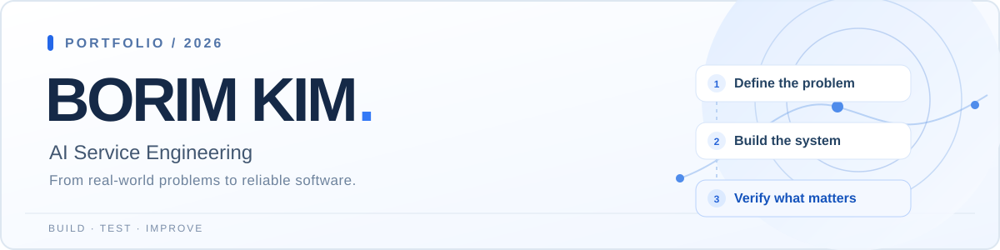
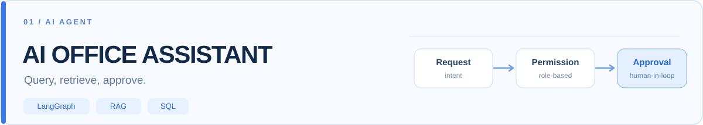
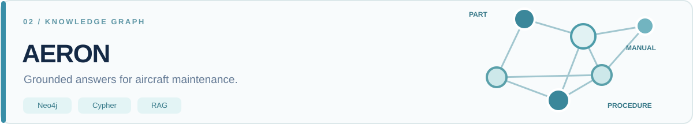
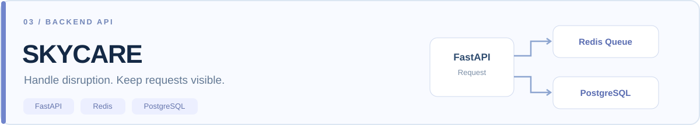

### 현장의 문제를 서비스로, AI의 판단을 검증 가능한 동작으로.

해양 분야의 업무 개선 경험을 시작으로 **AI Agent · RAG · Backend · 검증 자동화**를 공부하고 구현하고 있습니다.

---

### ✦ Featured Projects

<table>
<tr>
<td width="50%" valign="top">

**[생성형 AI 업무비서](https://github.com/rlaqhfla0917-bit/ai-office-assistant)**

LangGraph 기반 의도 분기, SQL/RAG 조회, 역할별 접근 통제 및 `interrupt()` 승인 흐름을 구현했습니다.

`Python` `LangGraph` `SQLite` `RAG`

**[소스코드](https://github.com/rlaqhfla0917-bit/ai-office-assistant)** · **[안전성 회귀 테스트](https://github.com/rlaqhfla0917-bit/ai-office-assistant/tree/main/tests)**

공개 Streamlit 시연은 모의 데이터 기반·읽기 중심. 메일 전송은 비활성화되어 있습니다.
</td>
<td width="50%" valign="top">

**[AERON | 항공정비 AI 서비스](https://github.com/rlaqhfla0917-bit/AERON)**

정비 매뉴얼·부품·결함 정보를 Neo4j 지식그래프로 연결하고, 근거 조회와 LLM 실패 시 대체 응답 흐름을 구현했습니다.

`Node.js` `Neo4j` `Cypher` `RAG`

**[소스코드](https://github.com/rlaqhfla0917-bit/AERON)** · **[웹 미리보기](https://rlaqhfla0917-bit.github.io/AERON/)**

웹 미리보기는 사전 구성한 가상 사례이며 실제 Neo4j·LLM에 연결되지 않습니다.
</td>
</tr>
</table>

**[SkyCare | 항공 지연·결항 API](https://github.com/rlaqhfla0917-bit/skycare-disruption-api)**

대체편 DB 조회·모의 데이터 폴백, Redis Queue 예약 요청 등록, Queue/DLQ 길이 및 예약 목록 조회를 구현했습니다.

`Python` `FastAPI` `Redis` `PostgreSQL`

**[소스코드](https://github.com/rlaqhfla0917-bit/skycare-disruption-api)** · **[정적 시연](https://rlaqhfla0917-bit.github.io/skycare-disruption-api/)** · **[예외 처리 테스트](https://github.com/rlaqhfla0917-bit/skycare-disruption-api/tree/main/tests)**

정적 데모는 실제 항공사 시스템과 연결되지 않습니다. 예약 완료 처리 Worker·실제 환불 연동은 구현 범위가 아닙니다.

---

### 🔬 Engineering & Verification

| 프로젝트 | 기술적으로 보여주는 역량 |
| :--- | :--- |
| 🐟 **[수산물 동적 가격 API](https://github.com/rlaqhfla0917-bit/seafood-dynamic-pricing-api)** | 6개 가격 조정 규칙, 합산식 가격 엔진, 재고 부족 `409` 예외, pytest 자동 테스트. **발표자료 기반 포트폴리오 재구현** |
| 🥗 **[예산 맞춤형 식단 추천](https://github.com/rlaqhfla0917-bit/budget-meal-planner)** | 공공 영양 데이터 연계, SciPy MILP 최적화 및 회귀 테스트. **공개 배포 준비 단계** |
| 🧪 **[TRACE 시료 인수인계](https://github.com/rlaqhfla0917-bit/trace-sample-handover)** | 현장 문제에 기반한 FastAPI·SQLite 웹 MVP. **실근무 당시 원본이 아닌 가상 데이터 재구현** |
| ☁️ **[CloudOps 분석 MVP](https://github.com/rlaqhfla0917-bit/cloudops-ai-assistant)** | 가상 장애 시나리오 분류, FastAPI, pytest 및 GitHub Actions |
| 🔐 **[금융사기 신고 API](https://github.com/rlaqhfla0917-bit/fraud)** | AWS Lambda · API Gateway · DynamoDB 기반 서버리스 설계 |
| 🎲 **[Nutri 웹 보드게임](https://github.com/rlaqhfla0917-bit/nutri)** | 공공 영양 데이터 기반 React·TypeScript 교육용 프로토타입 |

**검증 근거:** [Agent 안전성 테스트](https://github.com/rlaqhfla0917-bit/ai-office-assistant/actions) · [SkyCare 예외 테스트](https://github.com/rlaqhfla0917-bit/skycare-disruption-api/actions) · [가격 API 테스트](https://github.com/rlaqhfla0917-bit/seafood-dynamic-pricing-api/actions) · [AERON JS 검사](https://github.com/rlaqhfla0917-bit/AERON/actions)

> 자동 검사 성공은 해당 테스트·구문 검사 범위의 결과입니다. 실제 운영 보안, 모델 성능 또는 외부 서비스 연동을 보증하지 않습니다.

---

### 🧰 Tech Stack

**AI & Data**

    

**Backend & Cloud**

     

**Testing & Interface**

   

---

### 🏆 About

- **KT AIVLE School DX Consultant 9기** 수료
- **항공정비 AI 프로젝트 AERON** 7인 팀 PM · 빅프로젝트 우수상
- **KT AIVLE School 우수 기자단**
- 해양 분야 약 3년: 현장조사, 발주처·제안자료, 일정 조율, 시료 인수인계 개선

기술을 도입하는 이유부터 확인하고, 구현 범위와 검증 결과는 구분해 설명합니다.

